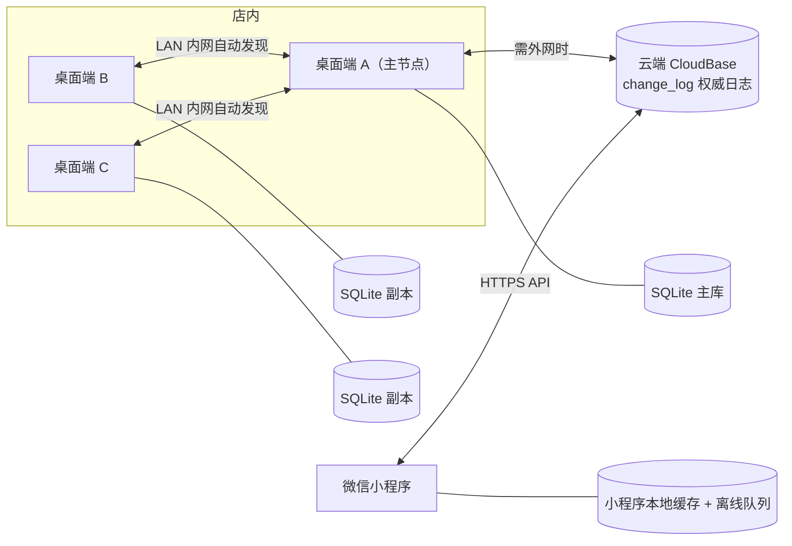

# 轻量级进销存出入库管理系统 — 总体设计（Design Spec）

- 日期：2026-10-16
- 状态：**已确认**（全部决策已定，见 §2 / §10）
- 范围：桌面端（Electron + Vue3 + SQLite）、微信小程序、云端（CloudBase / 自建）、端间同步与冲突处理

---

## 1. 定位与范围

- 使用规模：1–10 人，主要 1–5 人并发，单店 / 单一仓库群，**不做高并发架构**。
- 桌面端：Windows 优先，Electron + Vue3，`better-sqlite3` 作为离线主库，打包为免安装便携 `.exe`，**断网可全功能使用**。
- 小程序：只做「查库存 / 扫码 / 开销售出库单 / 看自己的应收」，不做后台管理。
- 目标：小团队自用，操作简单，**拒绝复杂 ERP**。

---

## 2. 关键设计决策（★ 为需要你确认的点）

| # | 决策 | 结论 | 状态 |
|---|---|---|---|
| D1 | 同步拓扑 | **局域网主节点 + 云端中转/备份**（见 §3） | ✅ 已确认 |
| D2 | 主键策略 | **ULID**（端本地生成，全局唯一），不用自增 | 必须如此，否则多端必冲突 |
| D3 | 同步粒度 | 同步「事实与意图」（单据、库存流水、主数据），**派生状态（库存余额、应收应付余额）各端本地重算，不同步计数** | ✅ 核心原则 |
| D4 | 成本核算 | **移动加权平均**（随流水本地重算，天然适配离线） | ✅ 已确认 |
| D5 | 单据状态机 | `待审核 → 已审核 → 已红冲`；已审核可**取消审核**回待审核；**只有已审核影响库存与账** | ✅ 已确认 |
| D6 | 计量单位 | **多计量单位**（基本单位 + 换算率，见 §5.0） | ✅ 已确认 |
| D7 | BOM | 不做（生产入库仅记录成品入库） | 按你原话 |
| D8 | 单据修改 | 单据 append-only；已审核后**可「取消审核」回待审核再修改**，也可红冲，但不可直接改删 | ✅ 已确认 |
| D9 | 小程序框架 | **原生小程序** | ✅ 已确认 |
| D10 | 云端选型 | **微信云开发 CloudBase**（云函数 + 云数据库） | ✅ 已确认 |
| D11 | 负库存 | 由 `sys_config.allow_negative_stock` **开关控制**（0=禁止，1=允许） | ✅ 已确认 |
| D12 | 审核流程 | 所有单据（订单 / 出入库 / 收付款）均需审核后才成立生效 | ✅ 已确认 |

---

## 3. 同步方案对比与选型

> 前置事实：**小程序生产环境无法直连局域网 IP**。`wx.request` 生产要求 HTTPS + 已 ICP 备案域名白名单，内网 IP 无法加入白名单。因此「局域网同步」实际只服务**店内多台桌面端之间**；小程序侧必须走云端或公网隧道。

| 方案 | 说明 | 优点 | 缺点 |
|---|---|---|---|
| A. 局域网主节点 + 云端中转/备份（**推荐**） | 店内指定 1 台桌面端为 LAN 主库（本地权威），其他桌面端经局域网同步；小程序经云端中转；云端与主节点双向同步 | 店内断外网仍全功能；实现量适中；天然满足「离线优先 + LAN 同步 + 后续上云」 | 需要一个端承担主节点角色 |
| B. 云端权威（中心辐射） | 云端唯一权威，桌面/小程序均为副本+离线队列 | 架构最简、单一真相源 | 店内多人并发依赖外网；断网并发时体验最差 |
| C. 纯局域网、暂不上云 | 全端平等，无中心，靠发现 + 日志合并 | 离线能力最强、零云成本 | 小程序接不进（受白名单限制）；跨地点不可用 |
| D. 混合：LAN 加速 + 云端汇总 | 双通道并存 | 能力最全 | 复杂度最高，对小团队过度设计 |

**选型：A（已确认），并保留向 D 平滑演进的余地。**
关键设计是让**同步引擎与传输层解耦**——业务代码只写入「操作日志」，传输层可以是 LAN HTTP/WebSocket，也可以是云端 API。这样「后续转云端联机」只需切换 transport，不动业务逻辑。

---

## 4. 同步引擎与冲突处理（重点）

### 4.1 核心思路

三句话概括：

1. **本地优先**：任何写入都先落本地 SQLite，并追加一条不可变的操作日志，永不阻塞用户。
2. **同步事实，不同步状态**：单据与库存流水是「事件」，天然 append-only，多端各写各的不会冲突；库存余额、应收应付余额是「派生状态」，各端从本地流水**重算**，因此不存在计数器冲突。
3. **行级 LWW + 字段级合并**：只有主数据（商品/客户/供应商/仓库等）的行内修改才可能真冲突，用逻辑时钟（HLC）判定先后，晚者胜；字段级可合并；同字段真冲突则留痕并人工裁决。

### 4.2 同步字段（所有业务表统一携带）

```sql
id            TEXT PRIMARY KEY,          -- ULID，端本地生成，全局唯一（不用自增，避免多端冲突）
created_by    TEXT NOT NULL,             -- 创建人 user_id
created_at    INTEGER NOT NULL,          -- 创建时间 epoch ms
updated_by    TEXT,                      -- 最后修改人 user_id
updated_at    INTEGER,                   -- 最后修改时间 epoch ms
version       INTEGER NOT NULL DEFAULT 1,-- 行版本，每次修改 +1（乐观锁）
origin_device TEXT NOT NULL,             -- 首次产生该行的设备 ID
hlc           TEXT NOT NULL,             -- 混合逻辑时钟 "物理毫秒:逻辑计数:deviceId"，用于 LWW 比较
dirty_fields  TEXT,                      -- 本次修改涉及的字段名 JSON 数组（用于字段级合并）
sync_state    INTEGER NOT NULL DEFAULT 0,-- 0=本地待同步 1=已同步 2=冲突待处理
deleted       INTEGER NOT NULL DEFAULT 0 -- 软删除（同步删除语义）
```

为什么用 **HLC 而非墙钟**：多台电脑系统时间可能不一致，直接用 `updated_at` 判先后会误判。HLC 保证「物理时间近似 + 因果序严格」。

### 4.3 同步流程（推拉模型）



1. **本地写入**：一个事务内 (a) 写业务表 (b) 追加 `_change_log`。
2. **推送**：把 `pushed = 0` 的日志按 `seq` 顺序 POST 给 peer（LAN 主节点）或云端，成功即标记。
3. **拉取**：按 `seq` 拉取增量，本地按 HLC「应用」（apply）。
4. **幂等与断点续传**：每批带 `(device_id, seq)`，接收方按 `log_id` upsert 去重；游标持久化在 `_sync_cursor`，网络恢复自动续传。
5. **传输通道**：主节点启动轻量 HTTP + WebSocket 服务（默认 8765），暴露 `/health`、`/sync/push`、`/sync/pull`、`/ws`；其他桌面端通过 mDNS 自动发现或手填 IP。小程序不参与 LAN，只走云端。

### 4.4 冲突场景与处理规则

| 场景 | 是否冲突 | 处理 |
|---|---|---|
| 两端各开一张出库单（同商品） | 否 | 均为新增事件，直接插入，库存由流水叠加派生 |
| 两端同时改同一商品的**不同字段** | 否（可合并） | 按 `dirty_fields` 字段级合并 |
| 两端同时改同一商品的**同一字段**（如售价） | 是 | HLC 晚者胜；同时写 `_conflict` 留痕，`sync_state=2`，可在「同步中心 / 冲突中心」人工回滚 |
| 同一单据一端「审核」、另一端「红冲 / 取消审核」 | 是（状态机冲突） | 按 HLC 定序；后到者做业务校验，若违反状态机（已红冲不可再改、已核销不可反审核）则标记冲突待处理 |
| 小程序离线开单时该商品已被停用 | 引用完整性 | 允许落单，但单据上标记「商品已停用」警告，不阻断 |
| 主数据被软删除后仍被引用 | 引用完整性 | 允许引用（软删除只是标记），列表隐藏、历史可查 |
| 库存允许超卖与否 | 业务规则 | 由 `sys_config.allow_negative_stock` 开关控制：`=1` 允许（无需冲突处理）；`=0` 禁止（出库**审核**时校验可用量，不通过则不允许审核生效，由主节点统一裁决） |

**勾稽原则**：库存与余额永远以**本地流水重算**为准（`stock_balance` 由 `stock_ledger` 聚合生成）。因此即使同步顺序错乱，重算结果最终一致（收敛）。

---

## 5. 数据库表结构

桌面端 SQLite 与云端逻辑同构（云端用同样的表名；`_sync_cursor` 仅在端侧）。所有业务表除业务字段外**统一追加 §4.2 的同步字段**（下文 DDL 中以 `-- [+同步字段]` 标注）。

### 5.0 公共字段与约定（所有表通用）

- **同步字段**：所有业务表统一追加 §4.2 的字段（下文 DDL 以 `-- [+同步字段]` 标注）。
- **审核字段**：所有单据表（订单 / 出入库 / 调拨 / 盘点 / 收付款）统一追加 `audited_by TEXT, audited_at INTEGER`；`status` 状态机统一为 `0 待审核 → 1 已审核 → 9 已红冲`。**只有 status=1（已审核）才成立生效**，才写库存流水与应收应付。
- **计量字段**：所有单据明细表统一追加 `unit_id TEXT, factor REAL DEFAULT 1, base_qty REAL`，其中 `factor` = 1 个该单位等于多少个基本单位，`base_qty = qty × factor`。
- **库存口径**：`stock_ledger` 与 `stock_balance` 的数量、成本金额、移动加权平均单价**一律以商品的基本单位记录**；多单位只发生在单据录入与展示层。
- **审核 / 取消审核（D8 已确认）**：状态机 `0 待审核 → 1 已审核 → 9 已红冲`；已审核单据**可「取消审核」回到 0 待审核**后继续修改。
  - 审核：写库存流水、生成 `ar_bill / ap_bill`。
  - 取消审核（反审核）：**不删除原流水**（保持 append-only），而是生成一条**反向冲销流水**（`reversal_of` 指向原流水），并作废对应的应收 / 应付单。
  - 反审核前置校验（任一不满足即禁止并提示具体原因）：对应应收 / 应付**已发生收付款核销**；**下游单据已引用**（采购订单已生成入库单、出库单已生成退货单）；单据**已红冲**。
  - 取消审核是**独立权限点**（如 `purchase.inbound.unaudit`）；审核 / 取消审核 / 红冲均写 `op_log`。

### 5.1 基础资料（主数据）

```sql
-- 计量单位
CREATE TABLE unit (
  id TEXT PRIMARY KEY, name TEXT NOT NULL, sort INTEGER DEFAULT 0, status INTEGER DEFAULT 1,
  -- [+同步字段]
);

-- 商品多计量单位换算（基本单位 factor=1；其余单位给出换算率）
CREATE TABLE product_unit (
  id TEXT PRIMARY KEY, product_id TEXT NOT NULL, unit_id TEXT NOT NULL,
  factor REAL NOT NULL DEFAULT 1,          -- 1 个该单位 = factor 个基本单位（如 1 箱 = 12 个）
  is_base INTEGER DEFAULT 0,               -- 是否基本单位
  barcode TEXT,                            -- 该单位专属条码（如整箱码）
  purchase_price REAL, sale_price REAL,    -- 可选：按单位分别定价
  -- [+同步字段]
);
CREATE UNIQUE INDEX ux_product_unit ON product_unit(product_id, unit_id);

-- 商品类别（多级）
CREATE TABLE product_category (
  id TEXT PRIMARY KEY, parent_id TEXT, code TEXT, name TEXT NOT NULL,
  path TEXT,           -- 物化路径，如 /root/1/8/，便于多级查询
  sort INTEGER DEFAULT 0, status INTEGER DEFAULT 1,
  -- [+同步字段]
);

-- 商品
CREATE TABLE product (
  id TEXT PRIMARY KEY,
  category_id TEXT, code TEXT NOT NULL,          -- 商品编号，唯一
  name TEXT NOT NULL,
  barcode TEXT,                                   -- 主条码
  spec TEXT, color TEXT,
  base_unit_id TEXT,                              -- 基本计量单位（库存一律以此单位记录）
  weight REAL, weight_unit TEXT,
  manufacturer TEXT,                              -- 生产厂商（文本或关联）
  default_warehouse_id TEXT, default_location_id TEXT,
  purchase_price REAL DEFAULT 0,                  -- 预设进价
  sale_price REAL DEFAULT 0,                      -- 预设售价
  cost_price REAL DEFAULT 0,                      -- 成本价（毛利核算，随流水更新）
  init_qty REAL DEFAULT 0, init_cost REAL DEFAULT 0, -- 期初建账数量与初始成本
  min_stock REAL, max_stock REAL,                 -- 预警阈值（可选）
  status INTEGER DEFAULT 1,                       -- 1=启用 0=停用
  -- [+同步字段]
);
CREATE UNIQUE INDEX ux_product_code ON product(code);

-- 商品条码（一商品多码，扫码可反查）
CREATE TABLE product_barcode (
  id TEXT PRIMARY KEY, product_id TEXT NOT NULL, barcode TEXT NOT NULL, remark TEXT,
  -- [+同步字段]
);
CREATE INDEX ix_barcode ON product_barcode(barcode);

-- 仓库
CREATE TABLE warehouse (
  id TEXT PRIMARY KEY, name TEXT NOT NULL, address TEXT, manager TEXT, status INTEGER DEFAULT 1,
  -- [+同步字段]
);

-- 货位 / 货架（可多层，parent_id 自关联）
CREATE TABLE location (
  id TEXT PRIMARY KEY, warehouse_id TEXT NOT NULL, parent_id TEXT,
  code TEXT, name TEXT NOT NULL, sort INTEGER DEFAULT 0, status INTEGER DEFAULT 1,
  -- [+同步字段]
);

-- 客户
CREATE TABLE customer (
  id TEXT PRIMARY KEY, name TEXT NOT NULL, contact TEXT, phone TEXT, address TEXT,
  price_level TEXT,          -- 默认售价等级
  credit_note TEXT,          -- 应收额度备注
  status INTEGER DEFAULT 1,
  -- [+同步字段]
);

-- 供应商
CREATE TABLE supplier (
  id TEXT PRIMARY KEY, name TEXT NOT NULL, contact TEXT, phone TEXT, address TEXT,
  settle_type TEXT,          -- 默认结算方式
  status INTEGER DEFAULT 1,
  -- [+同步字段]
);

-- 部门
CREATE TABLE department (
  id TEXT PRIMARY KEY, name TEXT NOT NULL, manager TEXT, status INTEGER DEFAULT 1,
  -- [+同步字段]
);

-- 用户 / 角色 / 权限
CREATE TABLE app_user (
  id TEXT PRIMARY KEY, account TEXT UNIQUE, name TEXT NOT NULL, pwd_hash TEXT,
  role_id TEXT, status INTEGER DEFAULT 1,
  -- [+同步字段]
);
CREATE TABLE role (
  id TEXT PRIMARY KEY, name TEXT NOT NULL, remark TEXT,
  -- [+同步字段]
);
CREATE TABLE role_permission (
  id TEXT PRIMARY KEY, role_id TEXT NOT NULL, perm_key TEXT NOT NULL, allowed INTEGER DEFAULT 1,
  -- perm_key 形如 "purchase.inbound.audit"（菜单/按钮级）
  -- [+同步字段]
);

-- 编码规则（类别码 + 流水号）
CREATE TABLE code_rule (
  id TEXT PRIMARY KEY, target TEXT NOT NULL,      -- product / customer / supplier / doc_no ...
  prefix TEXT, category_code TEXT, seq_len INTEGER DEFAULT 4, next_seq INTEGER DEFAULT 1,
  -- [+同步字段]
);
```

### 5.2 库存（派生 + 流水）

```sql
-- 库存流水（append-only，不可改删，只能红冲）
CREATE TABLE stock_ledger (
  id TEXT PRIMARY KEY,
  biz_type TEXT NOT NULL,      -- 期初/采购入库/销售出库/部门领用/生产入库/退货入库/退货出库/调拨/盘点/红冲
  doc_type TEXT, doc_id TEXT, doc_no TEXT,
  product_id TEXT NOT NULL, warehouse_id TEXT NOT NULL, location_id TEXT,
  qty_in REAL DEFAULT 0, qty_out REAL DEFAULT 0,
  unit_cost REAL DEFAULT 0, amount REAL DEFAULT 0,
  biz_date INTEGER NOT NULL, operator_id TEXT,
  reversal_of TEXT,            -- 红冲时指向被冲销的 ledger_id
  remark TEXT,
  -- [+同步字段]（注意：本表只做 insert，不做 update）
);

-- 库存余额（物化派生表，由流水重算；不参与主数据 LWW）
CREATE TABLE stock_balance (
  id TEXT PRIMARY KEY,         -- 建议 = product_id + ':' + warehouse_id + ':' + location_id
  product_id TEXT NOT NULL, warehouse_id TEXT NOT NULL, location_id TEXT,
  qty REAL DEFAULT 0,          -- 实时库存
  locked_qty REAL DEFAULT 0,   -- 占用量（已审核未出库等）
  avail_qty REAL DEFAULT 0,    -- 可用量
  cost_amount REAL DEFAULT 0,  -- 成本金额
  avg_cost REAL DEFAULT 0,     -- 移动加权平均单价
  recomputed_at INTEGER, recomputed_from_seq INTEGER
);
```

### 5.3 采购（入库链路）

```sql
-- 采购订单
CREATE TABLE purchase_order (
  id TEXT PRIMARY KEY, doc_no TEXT NOT NULL, supplier_id TEXT, warehouse_id TEXT,
  biz_date INTEGER, status INTEGER DEFAULT 0,      -- 0草稿 1已审 2关闭 9红冲
  handler_id TEXT, total_amount REAL DEFAULT 0, remark TEXT,
  -- [+同步字段]
);
CREATE TABLE purchase_order_item (
  id TEXT PRIMARY KEY, order_id TEXT NOT NULL, product_id TEXT,
  qty REAL, price REAL, amount REAL, remark TEXT,
  -- [+同步字段]
);

-- 采购入库单（含 部门领用 / 生产入库 / 退货 等类型）
CREATE TABLE purchase_inbound (
  id TEXT PRIMARY KEY, doc_no TEXT NOT NULL, inbound_type TEXT NOT NULL, -- 采购/部门领用/生产入库/退货入库
  supplier_id TEXT, warehouse_id TEXT, source_order_id TEXT,
  department_id TEXT, receiver_id TEXT, use_purpose TEXT,   -- 部门领用：领用部门/领用人/用途
  biz_date INTEGER, status INTEGER DEFAULT 0, handler_id TEXT,
  total_amount REAL DEFAULT 0, remark TEXT,
  -- [+同步字段]
);
CREATE TABLE purchase_inbound_item (
  id TEXT PRIMARY KEY, inbound_id TEXT NOT NULL, product_id TEXT, location_id TEXT,
  unit_id TEXT, factor REAL DEFAULT 1, qty REAL, base_qty REAL,
  price REAL, amount REAL, cost_price REAL, remark TEXT,
  -- [+同步字段]
);
```

### 5.4 销售（出库链路）

```sql
CREATE TABLE sales_order (
  id TEXT PRIMARY KEY, doc_no TEXT NOT NULL, customer_id TEXT, warehouse_id TEXT,
  biz_date INTEGER, status INTEGER DEFAULT 0, handler_id TEXT,
  total_amount REAL DEFAULT 0, remark TEXT,
  -- [+同步字段]
);
CREATE TABLE sales_order_item (
  id TEXT PRIMARY KEY, order_id TEXT NOT NULL, product_id TEXT,
  qty REAL, price REAL, amount REAL, remark TEXT,
  -- [+同步字段]
);

-- 销售出库单（出库时快照成本，供毛利表使用）
CREATE TABLE sales_outbound (
  id TEXT PRIMARY KEY, doc_no TEXT NOT NULL, outbound_type TEXT NOT NULL, -- 销售/退货出库
  customer_id TEXT, warehouse_id TEXT, source_order_id TEXT,
  biz_date INTEGER, status INTEGER DEFAULT 0, handler_id TEXT,
  total_amount REAL DEFAULT 0, remark TEXT,
  -- [+同步字段]
);
CREATE TABLE sales_outbound_item (
  id TEXT PRIMARY KEY, outbound_id TEXT NOT NULL, product_id TEXT, location_id TEXT,
  unit_id TEXT, factor REAL DEFAULT 1, qty REAL, base_qty REAL,
  price REAL, amount REAL,
  cost_price REAL, cost_amount REAL,          -- 成本快照（按基本单位），供「发货成本表 / 毛利表」直接取用
  remark TEXT,
  -- [+同步字段]
);
```

### 5.5 调拨 / 盘点（可选模块）

```sql
CREATE TABLE stock_transfer (
  id TEXT PRIMARY KEY, doc_no TEXT, from_warehouse_id TEXT, to_warehouse_id TEXT,
  biz_date INTEGER, status INTEGER DEFAULT 0, handler_id TEXT, remark TEXT,
  -- [+同步字段]
);
CREATE TABLE stock_transfer_item (
  id TEXT PRIMARY KEY, transfer_id TEXT, product_id TEXT, from_location_id TEXT, to_location_id TEXT, qty REAL,
  -- [+同步字段]
);
CREATE TABLE stock_check (
  id TEXT PRIMARY KEY, doc_no TEXT, warehouse_id TEXT, biz_date INTEGER,
  status INTEGER DEFAULT 0, handler_id TEXT, remark TEXT,
  -- [+同步字段]
);
CREATE TABLE stock_check_item (
  id TEXT PRIMARY KEY, check_id TEXT, product_id TEXT, location_id TEXT,
  book_qty REAL, real_qty REAL, diff_qty REAL,
  -- [+同步字段]
);
```

### 5.6 财务（应收应付）

```sql
-- 资金账户
CREATE TABLE account (
  id TEXT PRIMARY KEY, name TEXT NOT NULL, type TEXT,  -- 现金/银行/微信/支付宝
  balance REAL DEFAULT 0, status INTEGER DEFAULT 1,
  -- [+同步字段]
);

-- 应付
CREATE TABLE ap_bill (           -- 由采购入库生成
  id TEXT PRIMARY KEY, supplier_id TEXT NOT NULL, source_inbound_id TEXT,
  amount REAL DEFAULT 0, paid_amount REAL DEFAULT 0,
  status INTEGER DEFAULT 0, due_date INTEGER,
  -- [+同步字段]
);
CREATE TABLE ap_payment (        -- 付款单
  id TEXT PRIMARY KEY, doc_no TEXT, supplier_id TEXT, account_id TEXT,
  amount REAL DEFAULT 0, pay_date INTEGER, method TEXT, remark TEXT,
  -- [+同步字段]
);
CREATE TABLE ap_payment_apply (  -- 核销明细
  id TEXT PRIMARY KEY, payment_id TEXT, ap_bill_id TEXT, amount REAL,
  -- [+同步字段]
);

-- 应收
CREATE TABLE ar_bill (           -- 由销售出库生成
  id TEXT PRIMARY KEY, customer_id TEXT NOT NULL, source_outbound_id TEXT,
  amount REAL DEFAULT 0, received_amount REAL DEFAULT 0,
  status INTEGER DEFAULT 0, due_date INTEGER,
  -- [+同步字段]
);
CREATE TABLE ar_receipt (        -- 收款单
  id TEXT PRIMARY KEY, doc_no TEXT, customer_id TEXT, account_id TEXT,
  amount REAL DEFAULT 0, receive_date INTEGER, method TEXT, remark TEXT,
  -- [+同步字段]
);
CREATE TABLE ar_receipt_apply (
  id TEXT PRIMARY KEY, receipt_id TEXT, ar_bill_id TEXT, amount REAL,
  -- [+同步字段]
);
```

### 5.7 系统 / 同步 / 审计

```sql
-- 操作日志（同步的基石）
CREATE TABLE _change_log (
  log_id TEXT PRIMARY KEY,        -- ULID，幂等去重键
  seq INTEGER NOT NULL,           -- 本端自增序号
  device_id TEXT NOT NULL,
  entity TEXT NOT NULL, entity_id TEXT NOT NULL,
  op TEXT NOT NULL,               -- insert / update / delete
  payload TEXT,                   -- 变更后整行 JSON
  hlc TEXT NOT NULL,
  created_at INTEGER NOT NULL,
  pushed INTEGER DEFAULT 0
);
CREATE INDEX ix_changelog_seq ON _change_log(seq);
CREATE INDEX ix_changelog_pushed ON _change_log(pushed);

-- 同步游标
CREATE TABLE _sync_cursor (
  peer_id TEXT PRIMARY KEY,       -- 'lan:<deviceId>' / 'cloud'
  last_pull_seq INTEGER DEFAULT 0,
  last_push_seq INTEGER DEFAULT 0,
  last_sync_at INTEGER, status TEXT
);

-- 冲突记录
CREATE TABLE _conflict (
  id TEXT PRIMARY KEY,
  entity TEXT, entity_id TEXT, field TEXT,
  value_a TEXT, value_b TEXT, hlc_a TEXT, hlc_b TEXT,
  winner TEXT,                    -- a / b / manual
  resolved_value TEXT, resolved_by TEXT, resolved_at INTEGER,
  status INTEGER DEFAULT 0        -- 0待处理 1已裁决
);

-- 操作审计
CREATE TABLE op_log (
  id TEXT PRIMARY KEY, user_id TEXT, action TEXT, entity TEXT, entity_id TEXT,
  before_json TEXT, after_json TEXT, device_id TEXT, ip TEXT, at INTEGER
);

-- 系统配置 / 备份记录
CREATE TABLE sys_config (
  id TEXT PRIMARY KEY, cfg_key TEXT UNIQUE, cfg_value TEXT
  -- 关键配置：allow_negative_stock(0/1，默认 0) · backup_keep(默认 7) · theme · auto_launch · lan_port
);
CREATE TABLE backup_record (
  id TEXT PRIMARY KEY, file_path TEXT, size INTEGER, kind TEXT, at INTEGER, remark TEXT
);
```

---

## 6. 页面结构图

### 6.1 桌面端（Electron + Vue3，左菜单 + 表格工作区）

```
登录 / 选择操作员
└─ 工作台（首页：今日单据 · 库存预警 · 待同步提示）
   ├─ 基础资料
   │   ├─ 商品管理        列表 / 详情 / 新增编辑 / 库存预览 / 扫码查询
   │   ├─ 商品类别        多级树，增删改
   │   ├─ 计量单位
   │   ├─ 仓库管理
   │   ├─ 货位管理        货架 / 货位（按仓库）
   │   ├─ 客户管理
   │   ├─ 供应商管理
   │   ├─ 部门管理
   │   ├─ 编码规则        类别码 + 流水号
   │   └─ Excel 模板中心  下载模板 / 导入（逐行报错）/ 导出
   ├─ 采购（入库）
   │   ├─ 采购订单        列表 / 开单 / 转入库
   │   ├─ 采购入库单      列表 / 开单 / 审核 / 红冲
   │   ├─ 部门领用单      领用部门 · 领用人 · 用途
   │   └─ 生产入库单      成品 / 半成品入库
   ├─ 销售（出库）
   │   ├─ 销售订单
   │   ├─ 销售出库单      列表 / 开单 / 审核 / 红冲
   │   └─ 退货入库 / 退货出库（红字冲销）
   ├─ 库存
   │   ├─ 实时库存查询    按商品 / 仓库 / 货位筛选，含成本金额与可用量
   │   ├─ 库存流水        不可改删，可红冲
   │   ├─ 库存预警        低 / 高阈值标色
   │   ├─ 库存调拨
   │   └─ 库存盘点
   ├─ 财务
   │   ├─ 应收管理        应收单 / 收款单 / 核销
   │   ├─ 应付管理        应付单 / 付款单 / 核销
   │   └─ 资金账户流水
   ├─ 报表
   │   ├─ 进销存明细表
   │   ├─ 进销存汇总表    期初 + 本期入 − 本期出 = 期末
   │   ├─ 收货对账单      按供应商 + 时间
   │   ├─ 发货对账单      按客户 + 时间
   │   ├─ 发货成本表
   │   └─ 销售毛利表      销售额 − 成本额 = 毛利 / 毛利率
   └─ 系统
       ├─ 用户与角色权限  菜单 / 按钮级勾选
       ├─ 操作日志
       ├─ 同步中心        同步状态 · 冲突处理 · 手动同步
       ├─ 数据备份恢复    每日自动备份 + 手动备份 / 恢复
       └─ 设置            深 / 浅色主题 · 开机自启 · 扫码枪 · 主节点 IP
```

### 6.2 微信小程序（TabBar 4 个）

```
Tab1 工作台    库存预警摘要 · 扫一扫快捷入口 · 我的应收
Tab2 查库存    搜索 / 扫码 → 商品库存详情（各仓库 / 货位数量 · 可用量 · 成本）
Tab3 开单      选客户 → 扫码 / 搜索加商品 → 数量 · 售价 → 提交（支持离线草稿，恢复网络自动同步）
Tab4 我的      我的应收 · 我的单据 · 同步状态 · 切换账号
```

---

## 7. 模块与交付顺序

主数据 → 出入库 → 库存 → 财务 → 报表 → 小程序 → 同步联调（与你原定顺序一致）。

每个模块交付物：可运行功能 + 操作说明 + 「常见问题 / 数据出错如何回滚」说明。

---

## 8. 非功能设计

- **离线不丢单**：写入永远先落本地 + 操作日志，同步失败自动重试、断点续传。
- **备份**：每日自动备份 SQLite（本地 + 可选云），保留最近 N 份（默认 7，可配）；支持手动备份 / 恢复（zip）。
- **UI**：深 / 浅色主题可切换；表格优先，减少弹窗层级；扫码枪即定位商品并快速开单。
- **打包**：Windows 免安装便携 `.exe`（electron-builder portable），支持开机可选自启。
- **Excel**：内置模板（商品档案 / 客户 / 供应商 / 期初库存 / 采购入库 / 销售出库）；导入支持字段自动映射，**逐行报错并标出错误行**，允许修正后重导，不整批失败。

---

## 9. 风险与取舍

| 风险 | 应对 |
|---|---|
| 负库存 / 超卖 | D3 + 出库审核时校验可用量（需你确认是否允许负库存） |
| 系统时间不一致导致 LWW 误判 | 用 HLC 而非墙钟 |
| 主节点故障 | 主节点可切换（任一桌面端可被指为主节点）；云端保留全量日志 |
| 主数据真冲突 | 「冲突中心」留痕 + 人工裁决，可回滚 |
| 多端同改单据状态 | 单据状态机 + 业务校验，非法转移标记冲突 |

---

## 10. 已确认决策（设计冻结）

**确认清单（2026-10-16）**

1. D9 小程序框架 → **原生小程序**
2. D10 云端 → **微信云开发 CloudBase**
3. D4 成本核算 → **移动加权平均**
4. D6 计量单位 → **多计量单位换算（基本单位 + 换算率）**
5. D11 负库存 → **由 `sys_config.allow_negative_stock` 开关控制**
6. D12 审核 → **所有单据审核后才成立生效**
7. D1 同步拓扑 → **局域网主节点 + 云端中转/备份**（§3 方案 A）
8. D8 单据修改 → 已审核后**可取消审核**回待审核再修改（也可红冲），见 §5.0

**结构变更汇总**

- 新增表 `product_unit`（商品多单位换算：`product_id + unit_id + factor + is_base + barcode`）。
- `product.unit_id` → `product.base_unit_id`（基本单位）。
- 所有单据明细表追加 `unit_id / factor / base_qty`；库存流水与余额一律以**基本单位**记账。
- 所有单据表追加 `audited_by / audited_at`，`status` 统一为 `0 待审核 → 1 已审核 → 9 已红冲`。
- 新增「取消审核」动作：生成反向冲销流水（不删原流水）+ 作废对应应收 / 应付，附前置校验（§5.0）。
- `sys_config` 新增 `allow_negative_stock`（0=禁止，默认；1=允许）。禁止时出库**审核**校验可用量。

**无遗留待确认项，设计已冻结，可进入开发。**
